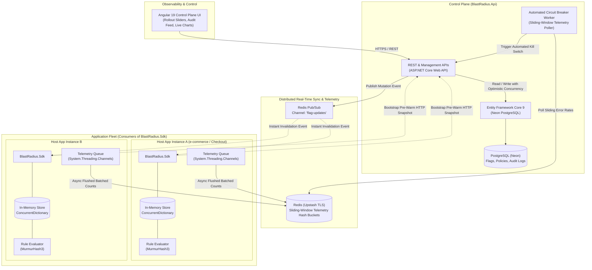
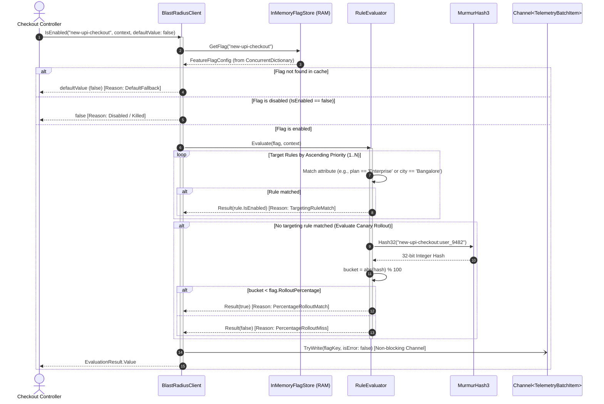
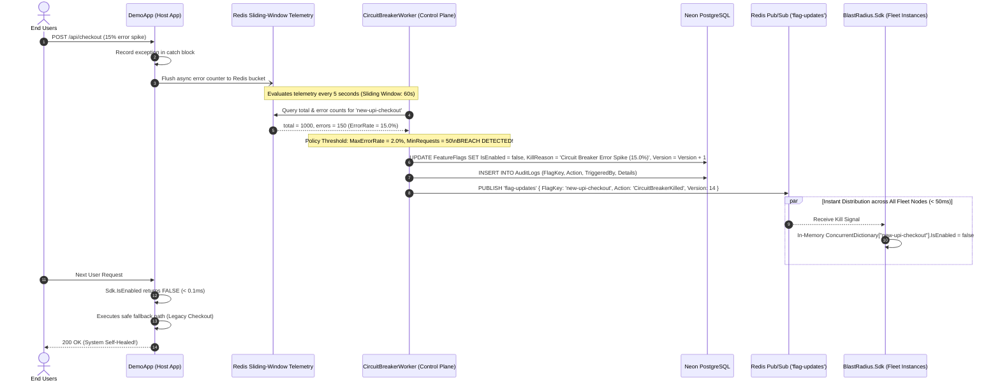

# BlastRadius Engine — Self-Healing Feature Flag & Blast-Radius Control Engine
## Industrial System Architecture Specification

---

## 1. Executive Summary & Problem Space

In modern cloud environments, **code deployment and feature activation are conflated**. Deploying a new software version exposes 100% of production traffic to newly committed logic simultaneously. When critical defects emerge (e.g., memory leaks, database connection pool exhaustion, or third-party payment gateway timeouts), remediation requires:
1. Detecting the degradation via external dashboards (5–15 minutes).
2. Triage and escalation to on-call engineering (5–10 minutes).
3. Initiating rollback PRs, CI/CD pipeline builds, container image pushes, and rolling restarts (15–30 minutes).

Total Mean Time to Recovery (**MTTR**) frequently exceeds **30 to 60 minutes**, causing catastrophic SLA violations, severe financial losses, and brand degradation.

**BlastRadius Engine** decouples deployment from release. It combines:
- **Zero-network-latency evaluation (< 0.5ms)** directly within host application memory via thread-safe lock-free data structures.
- **Deterministic canary rollouts** powered by MurmurHash3 consistent hashing, guaranteeing zero flicker across rollout expansions.
- **Autonomous distributed circuit-breaking** capable of detecting abnormal error rate spikes in real-time sliding windows and automatically isolating/disabling the defect within **50 milliseconds**—with zero human intervention and zero code redeployment.

---

## 2. Distributed Architecture & Component Topology

The system comprises three primary subsystems collaborating across a distributed state mesh:



---

## 3. End-to-End Architectural Workflows

### 3.1. Sub-Millisecond In-Memory Evaluation Flow

Every evaluation in the host application must satisfy strict non-blocking guarantees. Network round-trips are eliminated from the critical path:



---

### 3.2. Automated 50ms Circuit Breaker Kill Switch Sequence

When faulty logic causes runtime exceptions in the host application, the automated blast-radius circuit breaker detects the anomaly and isolates the feature across all nodes:



---

## 4. Key Architectural Decisions & Industry Justifications

| Architectural Component | Engineering Decision | Technical Justification |
| :--- | :--- | :--- |
| **Local Cache Storage** | `ConcurrentDictionary<string, FeatureFlagConfig>` | Lock-free reads via memory barriers; eliminates cross-thread contention on multi-core hosts; sub-microsecond retrieval. |
| **Consistent Hashing** | 32-bit x86 `MurmurHash3` | High avalanche characteristics, zero memory allocation, uniform distribution across `[0..99]`. Guarantees non-flicker canaries across scale-ups. |
| **Telemetry Ingestion** | Bounded `System.Threading.Channels` | Evaluation hot path never awaits Redis I/O. Drops or buffers telemetry safely if Redis network partitions occur. |
| **Distributed Notification** | Redis Pub/Sub (`flag-updates`) | Sub-10ms broadcast fanout across hundreds of container nodes. |
| **Cache Resilience** | HTTP Pre-warm + Periodic Polling | Guards against dropped Pub/Sub messages during network partitions or process restarts. Never purges cache on Redis disconnect. |
| **Telemetry Sliding Window** | Redis Time-Bucketed Hashes (`minute_epoch`) | Constant-time $O(1)$ writes and aggregated multi-bucket reads without memory explosion or sorted set overhead. |

---

## 5. Redis Telemetry Key Layout

Telemetry data is organized into rolling 60-second buckets:
```text
blastradius:telemetry:{environment}:{flagKey}:{minuteTimestamp}
  ├── total_evaluations: integer (INCRBY)
  ├── success_count:     integer (INCRBY)
  └── error_count:       integer (INCRBY)
```
Each key is set with an explicit `EXPIRE 300` (5 minutes TTL), eliminating dead metric storage.
